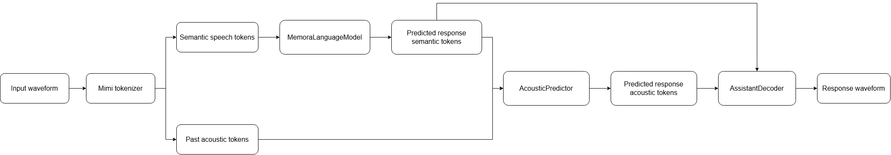

# Memora Speech

Memora Speech is a research prototype for live spoken dialogue. We are building it as an online system that hears a person, updates its recurrent memory as the conversation develops, predicts an appropriate response, and generates that response directly from learned speech tokens.

The semantic model is based on **Memora**, one of the recurrent memory architectures introduced by the **MIRAS** framework in Behrouz et al., [*It's All Connected: A Journey Through Test-Time Memorization, Attentional Bias, Retention, and Online Optimization*](https://arxiv.org/abs/2504.13173). Its memory weights update during the forward pass, allowing recent speech to alter subsequent predictions without retraining the model parameters between interactions.



Spoken-dialogue research code with three trainable stages:

1. `MemoraLanguageModel` predicts dialogue content with recurrent online memory.
2. `AcousticPredictor` predicts seven residual acoustic codebooks.
3. `AssistantDecoder` reconstructs the assistant waveform.

```bash
python -m venv .venv
.venv/bin/pip install -e .

python scripts/prepare_corpus.py --root data/conversations --sources data/sources
python scripts/synthesize_corpus.py --root data/conversations --hours 1300 \
  --assistant-voice models/assistant.onnx --user-voice models/user.onnx
python scripts/tokenize_corpus.py --root data/conversations
python scripts/train_semantic.py --data data/conversations --output models/semantic --epochs 5
python scripts/train_acoustic.py --data data/conversations/acoustic --output models/acoustic --epochs 5
python scripts/train_decoder.py --data data/conversations/acoustic --output models/decoder --steps 10000
python scripts/generate_dialogue.py --prompt-audio prompt.wav \
  --semantic-checkpoint models/semantic/best.pt \
  --acoustic-checkpoint models/acoustic/best.pt \
  --decoder-checkpoint models/decoder/best.pt
```

